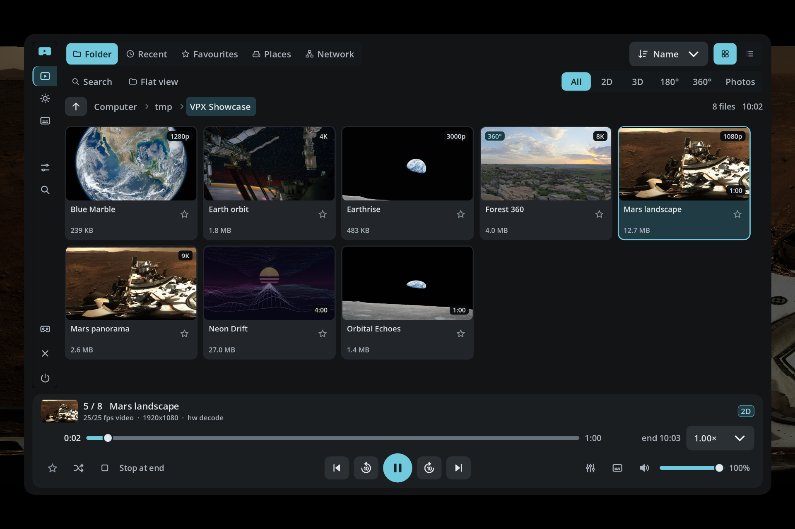
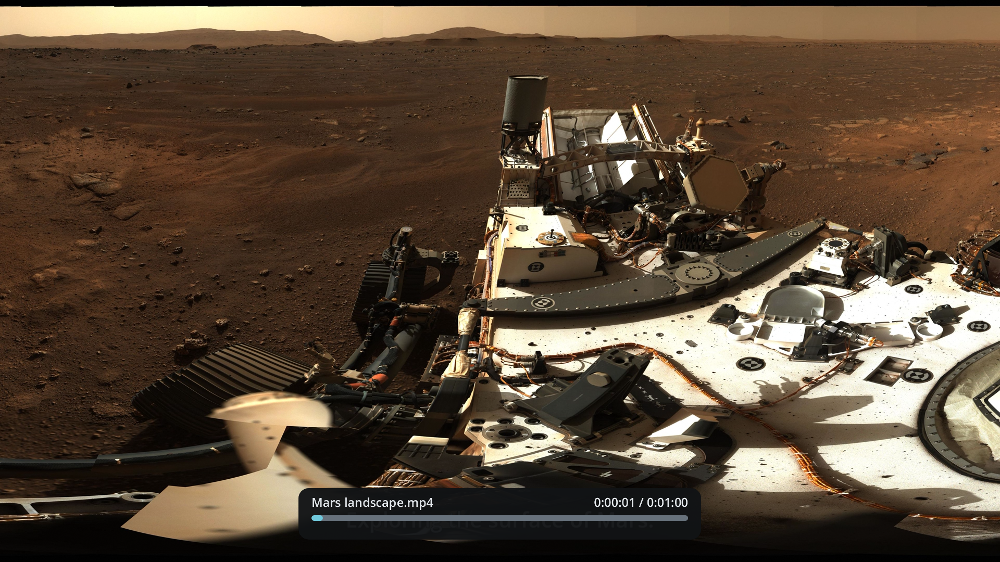
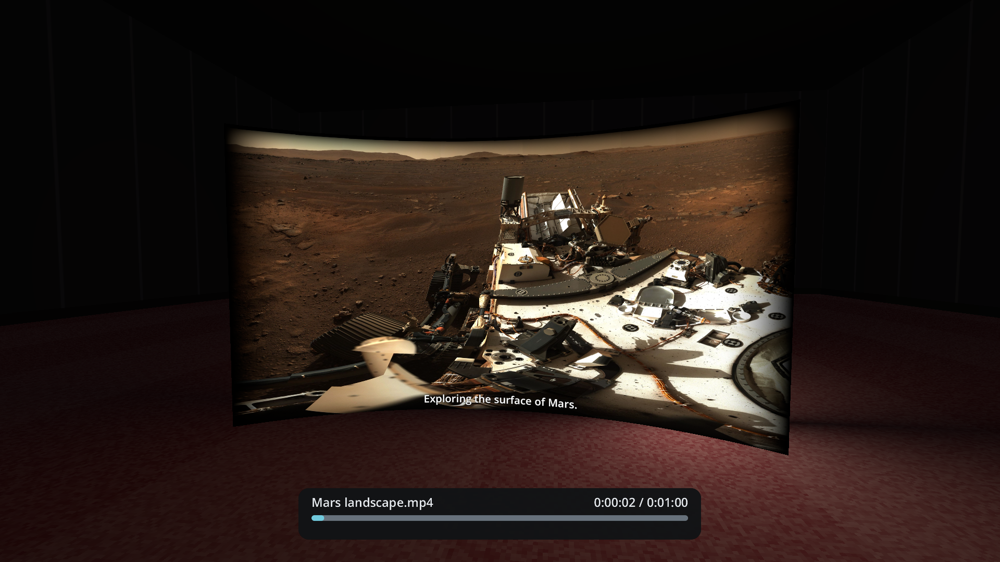
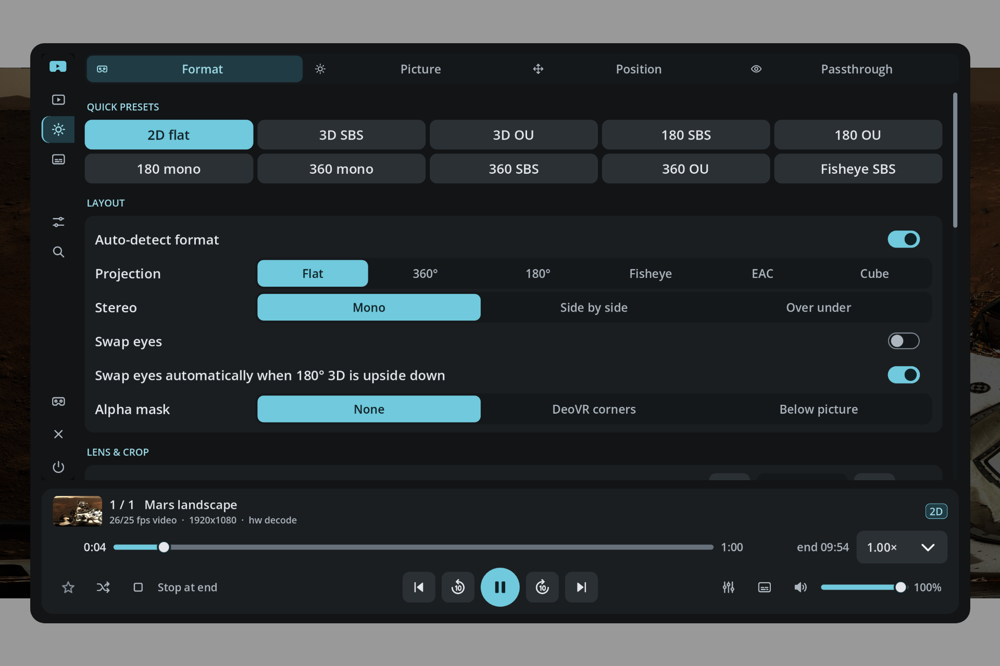
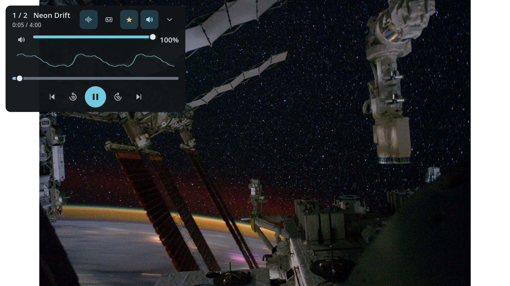
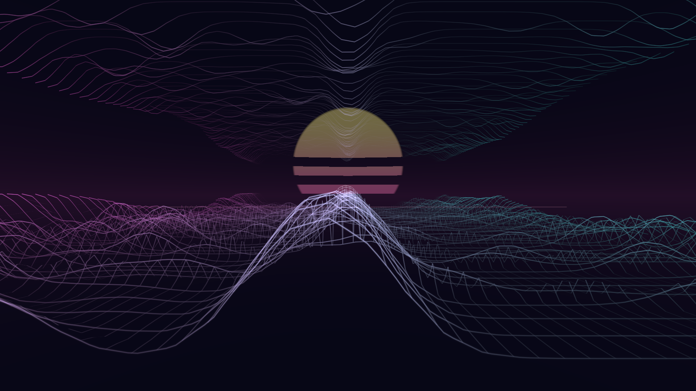

<div align="center">

# VPX — Multimedia Player for XR

A video, audio and panorama player for Windows and Linux, with source available.
Use it on desktop or in VR. Music can play over photos or with a 3D visualiser that reacts to the audio.

[](https://github.com/gicstin/VPX/releases/latest)
[](https://github.com/gicstin/VPX/releases)
[](https://discord.gg/uWmA64xdnr)

[](https://github.com/gicstin/VPX/releases/latest/download/VPX-windows-x86_64.exe)
[](https://github.com/gicstin/VPX/releases/latest/download/VPX-linux-x86_64.AppImage)

[All releases](https://github.com/gicstin/VPX/releases) · [Changelog](CHANGELOG.md) · [Report a bug](https://github.com/gicstin/VPX/issues/new?title=Bug%20report%3A%20) · [Request a feature](https://github.com/gicstin/VPX/issues/new?title=Feature%20request%3A%20)

</div>



## What it does

| Music & visuals | Video & panoramas | Library & playback |
| --- | --- | --- |
| Music visualiser scenes | Flat or curved cinema screen; 180° / 360°, fisheye, EAC and cubemaps | Local files, network shares, DLNA and web links |
| Beat, bass, frequency and stereo-position response | 2D, SBS / over-under 3D and Apple spatial video | Thumbnails, search, favourites and resume |
| Compact spectrum or oscilloscope; music over photos | Hardware decoding with software fallback, 10-bit video and HDR tone mapping | Subtitles, chapters, bookmarks and A–B loops |
| MP3, FLAC, WAV, AAC, Ogg / Opus and more through FFmpeg | Passthrough, picture controls and head-tracked audio | Shuffle, repeat, pitch-corrected 0.5–2× speed and sleep timer |

## Start playing

1. Download the **x86_64** package above. Windows: run the `.exe`. Linux: make the AppImage executable, then launch it:

   ```bash
   chmod +x VPX-linux-x86_64.AppImage
   ./VPX-linux-x86_64.AppImage
   ```

2. For VR, start your **OpenXR runtime** first. VPX uses desktop mode when VR is unavailable; **Enter VR / Exit VR** switches modes.
3. Open a file from **Library**.

Linux requires **glibc 2.38+**.

To use the music visualiser, play an audio file and press **Enter immersive music visualizer** on the floating player. Pick a scene under **Audio & subs → Resonance Field → Scene**. The intensity, depth sensitivity, motion and timing controls are there too.

Switch scenes with the player's style buttons, or a short thumbstick press in VR. When you leave the visualiser, the current photo comes back and the music keeps playing.

## Screenshots

<details>
<summary><strong>Video, cinema, panoramas and 3D formats</strong></summary>

| Video with subtitles | Curved cinema screen · scene preview |
| --- | --- |
|  |  |

| 360° panorama | 2D, 3D and VR formats |
| --- | --- |
|  |  |

</details>

<details>
<summary><strong>Music over photos and immersive visuals</strong></summary>

| Music over a photo | Immersive VR music visualiser |
| --- | --- |
|  |  |

Neon Mirror during playback. You can also use the compact spectrum or oscilloscope while viewing photos.

</details>

Sample imagery: [NASA](https://images.nasa.gov/) and [Poly Haven](https://polyhaven.com/a/kloppenheim_06).

## Controls & help

<details>
<summary><strong>Quick controls</strong></summary>

| Action | VR | Desktop |
| --- | --- | --- |
| Select | Trigger | Left click |
| Show / hide menu | B / Y or menu | Esc |
| Play / pause video | A / X | Space |
| Seek video | Stick ◀ / ▶ | ← / →; Shift for ±1 minute |
| Volume | Stick ▲ / ▼ | ↑ / ↓ |
| Recenter | Hold stick click for 1 second | R |
| Look around | Turn your head | Right mouse button + drag |
| Change immersive scene | Short stick click | Player's style buttons |

Use the **floating music player's buttons** for music transport and volume. More controller bindings are under **Settings → Controls**. Picture and format settings are saved per file.

</details>

<details>
<summary><strong>Playback help</strong></summary>

- **Wrong projection or 3D layout:** choose the matching preset in **Video → Format**.
- **Playback struggles:** try another decoding mode under **Settings → General**.
- **Web videos:** install the web-video helper from **Settings → General** when needed.
- **Report a bug:** include the VPX version, OS, VR setup and steps to reproduce. Check [existing issues](https://github.com/gicstin/VPX/issues) first.

</details>

Bug reports, testing and code contributions are welcome. If something is missing or broken, [open an issue](https://github.com/gicstin/VPX/issues) or [send a pull request](https://github.com/gicstin/VPX/pulls).

**License:** [PolyForm Noncommercial 1.0.0](LICENSE) for VPX. EIRTeam.FFmpeg retains its [MIT license](addons/ffmpeg/LICENSE); other dependencies retain their own licenses.

**VPX is free for noncommercial purposes.**
